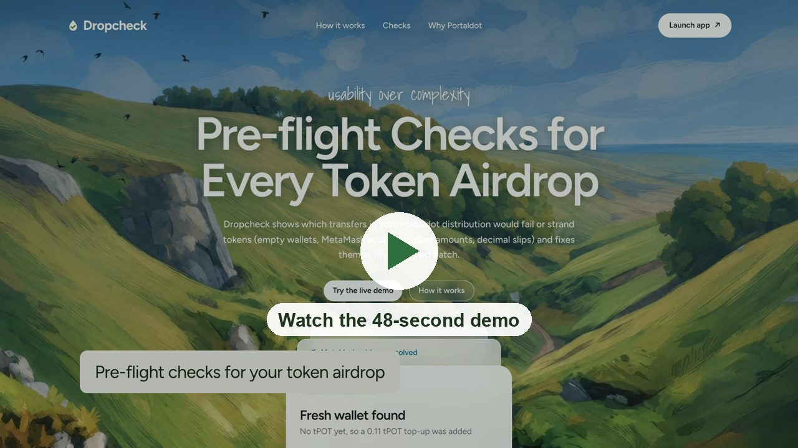
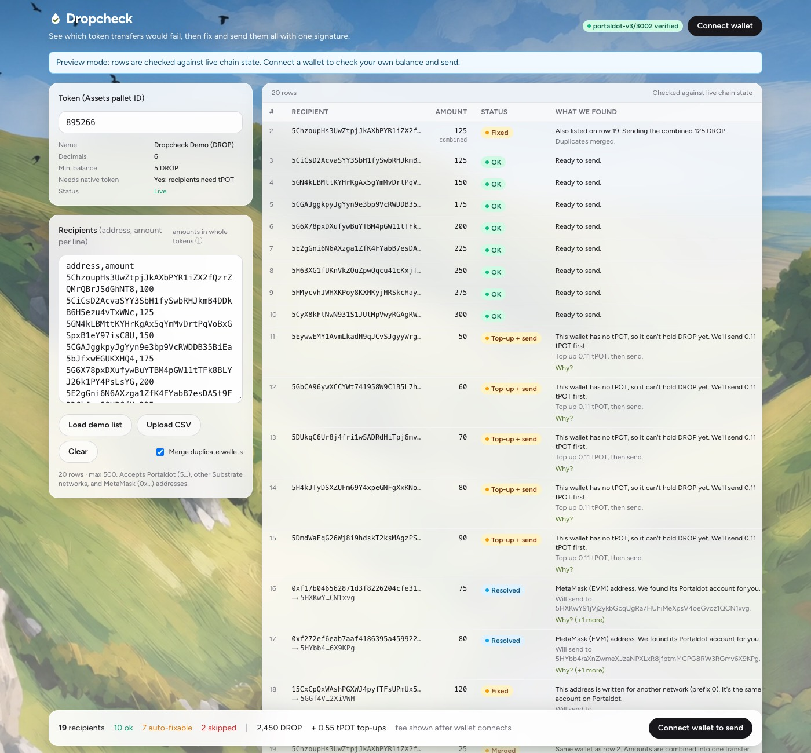
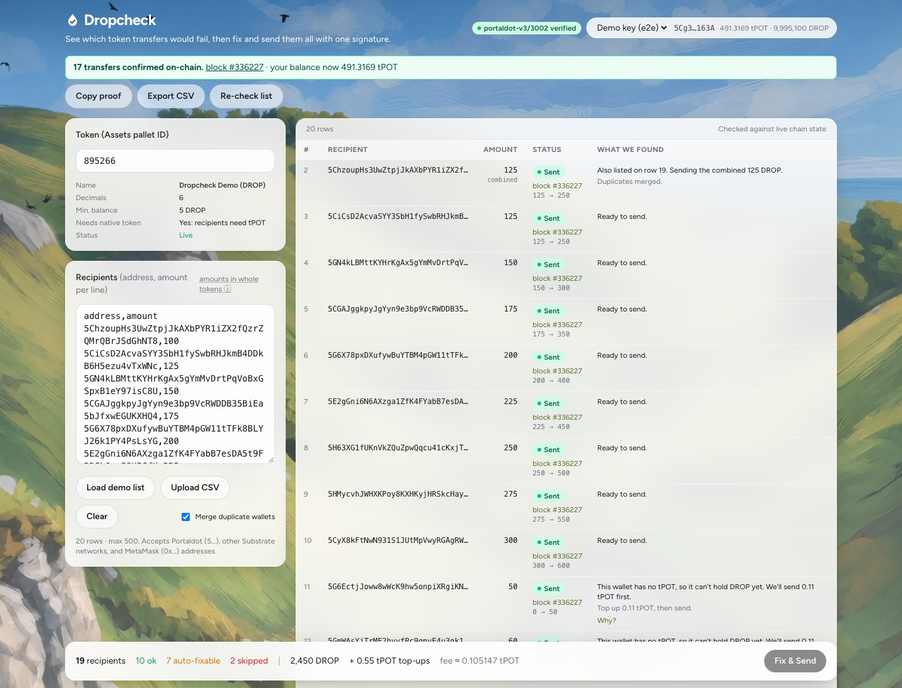
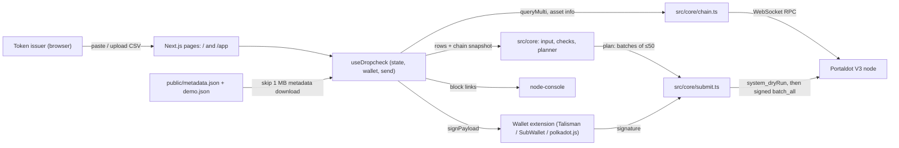
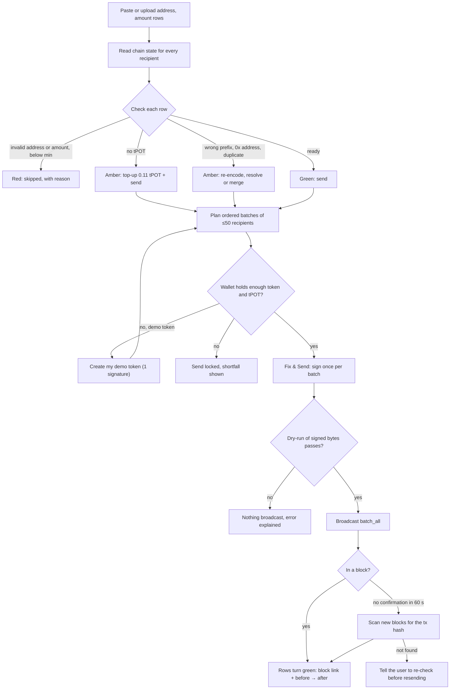

# Dropcheck

See which token transfers would fail, then fix and send them all with one signature.

    

Dropcheck is a browser app for community managers and token issuers who send a Portaldot Assets-pallet token to a list
of wallets. It checks every row against live chain state before anything is signed, explains each problem in plain
English, fixes what can be fixed, and sends everything as one atomic `Utility.batch_all`. It runs entirely in the
browser: no backend, no custody, and keys never leave your wallet extension.

Built for **Portaldot Hacker House 2026, Track 4: Ecosystem DApps**.

## Demo

[](https://dropcheck.mrfomolabs.xyz/demo.mp4)

**▶ [Watch the demo video (48 s, 1080p, narrated)](https://dropcheck.mrfomolabs.xyz/demo.mp4)**. Also in this repo:
[`video/dropcheck-film/renders/dropcheck-demo.mp4`](video/dropcheck-film/renders/dropcheck-demo.mp4).
The video shows the real app and a recorded live-V3 result (block #336227). It does not perform a new send on camera.

- [x] **Live app:** https://dropcheck.mrfomolabs.xyz (app: https://dropcheck.mrfomolabs.xyz/app/)
- [x] **Demo video:** https://dropcheck.mrfomolabs.xyz/demo.mp4
- [x] **Source:** https://github.com/mrfomoweb3/dropcheck
- [x] **On-chain proof:** demo token **asset 895266 (DROP)** and every transaction with block links in [docs/PROOF.md](docs/PROOF.md)

| Checked before sending | After one signature |
|---|---|
|  |  |

## Table of contents

- [Problem](#problem)
- [Solution](#solution)
- [How to test](#how-to-test)
- [Architecture](#architecture)
- [Flowchart](#flowchart)
- [Tech stack](#tech-stack)
- [Getting started](#getting-started)
- [Project structure](#project-structure)
- [Deployment](#deployment)
- [Usage](#usage)
- [Roadmap](#roadmap)
- [Contributing](#contributing)
- [License](#license)
- [Team and acknowledgements](#team-and-acknowledgements)

## Problem

Token airdrops on Substrate chains fail, or silently lose tokens, for reasons the sender can't see in advance:

- **New wallets can't receive the token.** A wallet with no native token (tPOT) can't hold a non-sufficient asset, so
  the transfer fails with `TokenError.CannotCreate`. **All 21 assets on Portaldot V3 today are non-sufficient**, so
  every brand-new recipient hits this. Verified on live V3, block #336163.
- **Amounts below the token's minimum** fail with `TokenError.BelowMinimum` (block #336165).
- **Decimal mistakes.** The native token has 14 decimals. A missing zero sends 10× or 1/10 of what was meant.
- **The sender can wipe out their own account.** If amount + fee drops the sender below the existential deposit, the
  account is reaped and the rest is lost.
- **MetaMask (0x…) recipients** need a manual runtime-call lookup to find their Portaldot account.
- **Typos, wrong-network addresses and duplicate rows** are only found after a failed transfer.

Sending one by one in a block explorer means one signature and one fee per row, and failures show up mid-run.

Evidence from other teams: [Integritee](https://hackmd.io/@brenzi5/B1jBRMUb5) (decimal mistake reaped an account) ·
[Talisman ED docs](https://docs.talisman.xyz/talisman/help-and-support/troubleshooting/ed) ·
[Polkassembly #2364](https://polkadot.polkassembly.io/post/2364) (tokens stuck without native balance) ·
[Portaldot V3 guide](https://github.com/ItsCogumellum/portaldot-v3-testnet-guide) (manual EVM address lookup) ·
[Polkadot forum RFC](https://forum.polkadot.network/t/polkadot-protocol-proposals-rfc-process/1421/31).

## Solution

Paste or upload a list of `address, amount` rows. Dropcheck reads the chain state for every recipient, marks each row
**red / amber / green** with the reason and the fix, and builds one plan. **Fix & Send** signs it once. Before broadcasting,
the node dry-runs the exact signed bytes, so a batch that would fail is never sent.

### Key features

- **13 checks per row**, each with a plain-English reason: `ADDR_INVALID` · `ADDR_WRONG_PREFIX` (re-encodes) ·
  `ADDR_EVM` (resolves) · `AMOUNT_INVALID` · `DUPLICATE` (merges) · `NO_PROVIDER` (adds a top-up) · `BELOW_MIN_BALANCE` ·
  `RECIPIENT_FROZEN` · `ASSET_FROZEN` · `DECIMAL_SUSPECT` · `SENDER_SHORT_ASSET` · `SENDER_SHORT_NATIVE` · `EVM_VISIBILITY`.
- **Automatic top-ups.** A recipient with no tPOT first gets ED + 10% (0.11 tPOT), then the token, in the same atomic batch.
- **One signature, safe by construction.** `batch_all` is all-or-nothing; the signed bytes are dry-run first
  (`system_dryRun`) and only broadcast if they pass.
- **MetaMask addresses resolved** through `ReviveApi.account_id`, with the runtime's fallback mapping.
- **Large lists** split into ordered batches of 50 recipients, one signature each.
- **Proof built in.** Every sent row links to its block and shows its before → after balance. Copy the proof or export a CSV.
- **Anyone can run the demo.** A visitor with about 3 tPOT clicks **Create my demo token** to get their own copy of the demo
  token, then sends the demo list. The demo's "new wallet" rows are regenerated on every page load, so they never go stale.

## How to test

You need a Portaldot wallet extension ([Talisman](https://talisman.xyz), [SubWallet](https://subwallet.app) or
[polkadot{.js}](https://polkadot.js.org/extension/)) holding about **3 tPOT** on Portaldot V3 testnet. There is no public
faucet. Testnet tPOT comes through the hackathon registration form. Without tPOT you can still do steps 1–2.

### Try this

1. **Open the app** at https://dropcheck.mrfomolabs.xyz/app/, or run it locally at http://localhost:3000/app/.
   *Expected:* the header shows `portaldot-v3/3002 verified`. The demo list loads and is checked against live chain state:
   10 OK, 7 auto-fixable, 2 skipped. 5 rows show **Top-up + send**, and the 2 MetaMask rows show **Resolved**.
2. **Click "Why?"** on a red or amber row.
   *Expected:* the exact rule and chain error behind it, for example `TokenError.CannotCreate` for a wallet with no tPOT.
3. **Connect wallet.**
   *Expected:* a card says your wallet doesn't hold the demo token, with the exact cost: 2.18 tPOT held as the token
   deposit (not spent), about 0.024 tPOT fee, and about 0.66 tPOT for the send.
4. **Create my demo token** and sign once.
   *Expected:* "Your demo token … was created in block #…". The list switches to your token.
5. **Fix & Send → Sign once.**
   *Expected:* "17 transfers confirmed on-chain". 17 rows show **Sent** with a block link and before → after balance.
   2 rows are skipped (invalid address, below minimum), and 1 duplicate is merged.
6. **Click a block link.**
   *Expected:* the block opens in node-console with a `utility.batchAll` containing 5 `balances.Transfer` and
   17 `assets.Transferred` events.

### Automated tests

```bash
pnpm test        # 40 unit tests, no network
```

Passing looks like `Tests  40 passed (40)`.

```bash
pnpm typecheck && pnpm lint && pnpm build
```

Live tests send real testnet transactions and need a funded demo key (see [Environment variables](#environment-variables)):

```bash
pnpm test:live   # on live V3: 1 signature → 5 top-ups + 17 transfers; appends the tx to docs/PROOF.md
```

### What has been verified, and how

| Claim | Status |
|---|---|
| Checks against live chain state, in the browser and headless | ✅ live V3 |
| H160 → native mapping via `ReviveApi.account_id` | ✅ live V3 (test A2) |
| Dry-run catches a failing batch; nothing is broadcast | ✅ live V3 and on a V3 fork |
| 1 signature → 5 top-ups + 17 transfers; fresh wallets receive the token; sender never reaped | ✅ live V3, headless (block #336184) and in the production UI (block #336227) |
| 55 recipients → 2 batches (100 + 10 calls), all 55 received | ✅ live V3 (blocks #337909, #337912) |
| First-time visitor: Create my demo token → Fix & Send, 17 sent, 48.5 s | ✅ live V3, production UI (blocks #338420, #338422) |
| App connects after a runtime upgrade (non-matching metadata, empty cache) | ✅ simulated against live V3: 5/5 connected in 25–40 s |
| A send whose confirmation is lost is still reported | ✅ the problem was seen on live V3: a test send landed (block #337949, 17 transfers) while the UI never got the confirmation. The 60 s watchdog now finds the tx in the chain. The watchdog's recovery has not yet been triggered by a real dropped socket |
| Send through a real browser extension (Talisman / SubWallet / polkadot.js) | ⏳ not yet run. The UI tests inject their own signer. The extension path uses the standard `@polkadot/extension-dapp` signer |
| Time saved vs. sending one by one in node-console | ⏳ not measured. Any number quoted is an estimate |

Sources and dates for every claim: [docs/EVIDENCE.md](docs/EVIDENCE.md). Spike results: [docs/SPIKE.md](docs/SPIKE.md).

## Architecture



- **Pages (`src/app`)**: the landing page (`/`) and the app (`/app`). A static export, so it can be hosted anywhere.
- **`useDropcheck`**: holds the connection, wallet, list, chain state, fee and send state. One shared connection per page.
- **`src/core`**: framework-free logic. `input` parses rows, `checks` classifies each row, `planner` builds the batches,
  `chain` connects and reads state, `submit` signs, dry-runs, broadcasts and parses events, `demo` regenerates fresh rows.
- **Wallet extension**: signs. Dropcheck never sees a key.
- **Portaldot V3 node**: the Assets, Balances and Utility pallets, `ReviveApi.account_id` for MetaMask addresses, and
  `system_dryRun`. The app refuses to send on any genesis other than V3 testnet.
- **Static files**: a metadata snapshot so the browser skips a slow 1 MB download, and the demo list.

More detail: [docs/ARCHITECTURE.md](docs/ARCHITECTURE.md).

## Flowchart



## Tech stack

| Area | Tools |
|---|---|
| Frontend | Next.js 15 (static export), React 19, Tailwind CSS 3, Figtree + Shadows Into Light fonts |
| Chain access | `@polkadot/api` 17, `@polkadot/util`, `@polkadot/util-crypto`, `@polkadot/keyring` |
| Wallet | `@polkadot/extension-dapp` (Talisman, SubWallet, polkadot{.js}) |
| Blockchain | Portaldot V3 testnet: Assets, Balances, Utility pallets, Revive address mapping. No smart contract |
| Parsing | PapaParse |
| Testing | Vitest (unit + live), Puppeteer (browser end to end), Chopsticks (local fork rehearsal) |
| Tooling | TypeScript 5.9, ESLint 9, tsx, pnpm |
| Hosting | Vercel (static, see `vercel.json`) |

## Getting started

### Prerequisites

- Node.js **20.6 or newer** (needed for `--env-file`; developed on Node 24.9)
- pnpm 10 (developed on 10.30)
- Google Chrome, only for the Puppeteer UI scripts
- For live scripts only: a demo-only key funded with tPOT on Portaldot V3 testnet

### Installation

```bash
git clone https://github.com/mrfomoweb3/dropcheck.git
cd dropcheck
pnpm install
```

### Environment variables

The app needs none. Copy `.env.example` to `.env` only to override endpoints or to run the live scripts.

| Variable | Used by | Purpose | Required |
|---|---|---|---|
| `DEMO_SEED_FILE` | live scripts and tests | Path to a demo-only seed file **outside the repo**, `chmod 600`. Never put a seed in `.env` | Only for `seed-demo`, `test:live`, `spike:funded`, `demo:headless --send` |
| `NEXT_PUBLIC_DROPCHECK_WSS` | app (build time) | Substrate WebSocket endpoint. Default `wss://test-node-v3.portaldot.dev` | No |
| `NEXT_PUBLIC_DROPCHECK_EVM_RPC` | app (build time) | EVM JSON-RPC endpoint. Default `https://test-evm-rpc-v3.portaldot.dev` | No |
| `NEXT_PUBLIC_DROPCHECK_EXPLORER` | app (build time) | Block explorer base URL. Default `https://node-console.portaldot.dev` | No |
| `NEXT_PUBLIC_DROPCHECK_GENESIS` | app (build time) | Expected genesis hash. Default is V3 testnet | No |
| `NEXT_PUBLIC_DROPCHECK_SPEC` | app (build time) | Expected runtime spec name. Default `portaldot-v3` | No |

A pre-commit hook (`scripts/check-secrets.sh`) blocks commits that look like they contain a seed or key.

### Run locally

```bash
pnpm dev
```

Open http://localhost:3000 for the landing page, or http://localhost:3000/app/ for the app.

Don't run `pnpm build` while `pnpm dev` is running: both use `.next`, and the dev server breaks. If that happens, stop
it, delete `.next`, and start `pnpm dev` again.

## Project structure

```text
src/
  app/                  Next.js pages (/ landing, /app), useDropcheck hook, components
    components/         Header, InputPanel, ResultsTable, SendFlow, DemoToken, …
  core/                 Framework-free logic (BigInt amounts only)
    input.ts            Parse pasted / uploaded rows
    checks.ts           The 13 row checks and run-level checks
    planner.ts          Top-ups first, then transfers, in batches of ≤50
    chain.ts            Connect (metadata snapshot, upgrade probe), identity check, state reads, H160 mapping
    submit.ts           batch_all, fee, sign → dry-run → broadcast, event parsing, lost-confirmation recovery
    demo.ts             Fresh-row regeneration and visitor demo-token helpers
  config/chain.ts       Endpoints, expected genesis, ?rpc= override
public/                 metadata.json snapshot, demo.json, background art
scripts/                Demo seeding, headless runner, metadata refresh, Puppeteer UI tests
spike/                  Chain spike scripts (live and fork), Chopsticks config
tests/unit/             40 unit tests
tests/live/             Live V3 golden-path test
docs/                   ARCHITECTURE, EVIDENCE, PROOF, SPIKE, REHEARSAL, DEMO, NON-GOALS
```

## Deployment

There is no smart contract. Dropcheck uses Portaldot's native pallets, so the on-chain artifacts are:

| Artifact | Value |
|---|---|
| Network | Portaldot V3 testnet, genesis `0xd4f9acbcf7f52388d8b095abe3c198d19fc510e0343e643e87cfbccb155283bd`, runtime `portaldot-v3/3002` |
| Demo token | Asset **895266** (Dropcheck Demo, DROP, 6 decimals, min balance 5 DROP, non-sufficient) |
| Demo sender | `5Cg3VnuJTQQKwC9bcTVRXM1ygaMj7vRzPQ39jdp71NVd163A` |
| Example send | [block #336227](https://node-console.portaldot.dev/?rpc=wss%3A%2F%2Ftest-node-v3.portaldot.dev#/explorer/query/336227): 1 signature, 5 top-ups + 17 transfers |

All transactions, with block links: [docs/PROOF.md](docs/PROOF.md).

**Hosting.** The app is a static export (`out/`). On Vercel, `vercel.json` sets the install and build commands, and
`pnpm build` refreshes the metadata snapshot first, keeping the old one if the node is slow:

```bash
vercel --prod
```

Any static host works. Serve the `out/` folder after `pnpm build`.

## Usage

**In the browser**

| Action | How |
|---|---|
| Check a list | Enter the token's asset ID, paste `address,amount` rows (amounts in whole tokens) or upload a CSV |
| Use another node | Add `?rpc=wss://<node>` to the URL. Only `wss://` (or `ws://localhost`) is accepted, and the genesis check still applies |
| Keep the proof | After sending, use **Copy proof** or **Export CSV** |

Example input:

```csv
address,amount
5ChzoupHs3UwZtpjJkAXbPYR1iZX2fQzrZQMrQBrJSdGhNT8,100
0xf17b046562871d3f8226204cfe316edc243be65d,75
```

**From the command line**

| Command | What it does |
|---|---|
| `pnpm demo:headless --asset 895266 --list public/demo-list.csv` | Runs the checks on a list from the terminal (read-only) |
| `pnpm demo:headless --asset 895266 --list public/demo-list.csv --send` | Same, then sends with the demo key |
| `pnpm seed-demo` | Creates the demo token if needed and writes `public/demo.json` + `public/demo-list.csv` |
| `pnpm fetch-metadata` | Refreshes `public/metadata.json` after a runtime upgrade |
| `pnpm spike` / `pnpm spike:funded` | Chain spike: read-only checks / the funded failure and top-up experiments |
| `pnpm smoke` | Browser smoke test of a running app |

Generate a demo-only key (writes the seed file with mode 600 and prints only the address to fund):

```bash
npx tsx scripts/gen-demo-key.ts ~/.dropcheck/demo-seed
```

## Roadmap

- [x] Row checks with plain-English reasons and fixes
- [x] Automatic top-ups for wallets with no tPOT, in the same atomic batch
- [x] MetaMask address resolution via `ReviveApi.account_id`
- [x] One signature per batch, dry-run of the signed bytes before broadcast
- [x] Batches of ≤50 recipients, verified on live V3 with 55
- [x] Visitor demo token, so anyone with tPOT can run the full demo
- [x] Recovery from runtime upgrades and dropped node connections
- [x] Every claim checked on live Portaldot V3, with block links in [docs/PROOF.md](docs/PROOF.md)
- [x] Deployed at https://dropcheck.mrfomolabs.xyz
- [x] Demo video (48 s, narrated)
- [x] README with test script, architecture and flow diagrams
- [ ] Verified send through each real extension (Talisman, SubWallet, polkadot.js)
- [ ] Measured baseline vs. sending one by one in node-console
- [ ] Fallback to a second V3 endpoint, once one exists
- [ ] Mainnet support (deliberately out of scope for now, see [docs/NON-GOALS.md](docs/NON-GOALS.md))

## Contributing

1. Fork the repo and create a branch: `git checkout -b fix/short-name`.
2. Keep `src/core` framework-free, and use `BigInt` base units for every amount (never `Number`).
3. Run `pnpm typecheck && pnpm lint && pnpm test` before pushing. Add a unit test for any new check.
4. Never commit a seed or private key. The pre-commit hook enforces this; don't bypass it.
5. Label claims in docs as verified (on live V3 or on a fork), from docs, or an assumption.
6. Open a pull request describing what changed and how you tested it.

## License

_Add a license_

## Team and acknowledgements

- **Team:** _add team name and members_
- Built for **Portaldot Hacker House 2026**, Track 4: Ecosystem DApps.
- Libraries: polkadot.js (`@polkadot/api`, `util`, `util-crypto`, `extension-dapp`, `keyring`), Next.js, React,
  Tailwind CSS, PapaParse, Vitest, Puppeteer, and [Chopsticks](https://github.com/AcalaNetwork/chopsticks) for fork rehearsals.
- Problem evidence: Integritee, Talisman, Polkassembly, the Portaldot V3 testnet guide, and the Polkadot forum (links in
  [Problem](#problem)).

**AI assistance disclosure.** This project was built with AI assistance (Claude Code) for code, tests and docs. On-chain
claims were verified by running the scripts against Portaldot V3. See [docs/EVIDENCE.md](docs/EVIDENCE.md).
